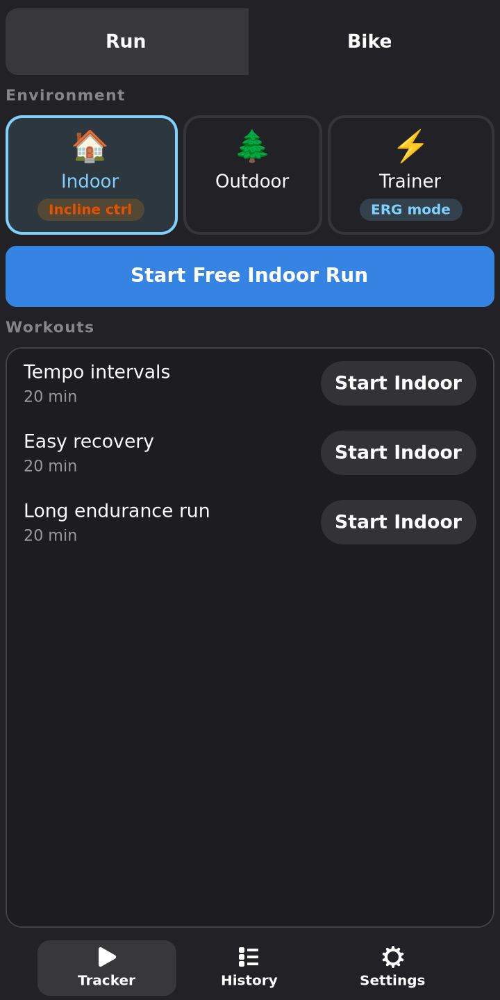
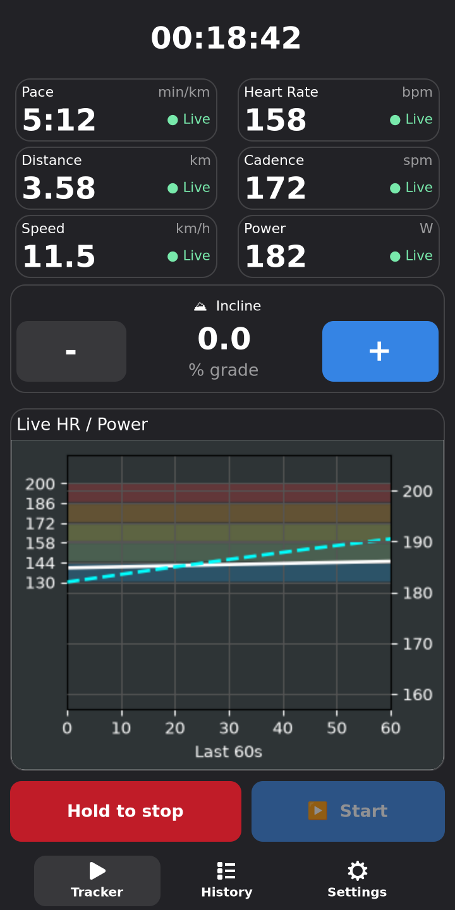
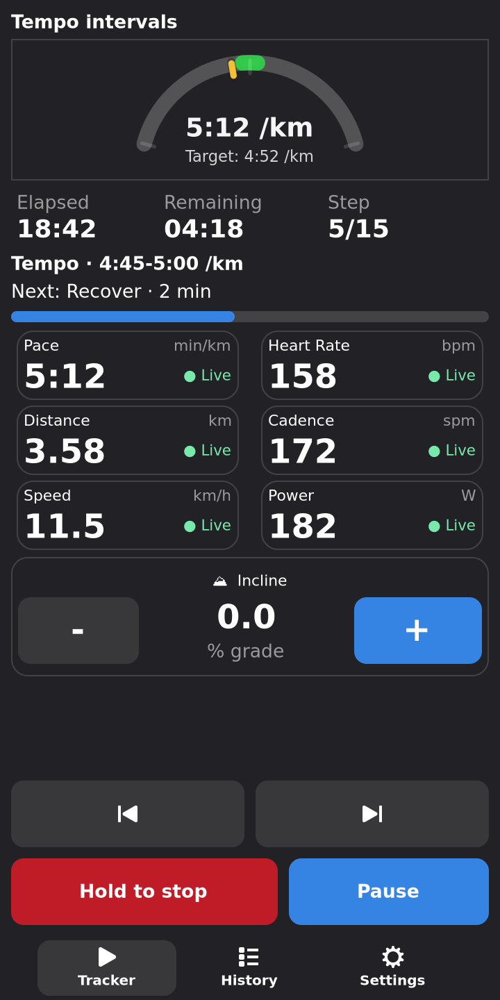
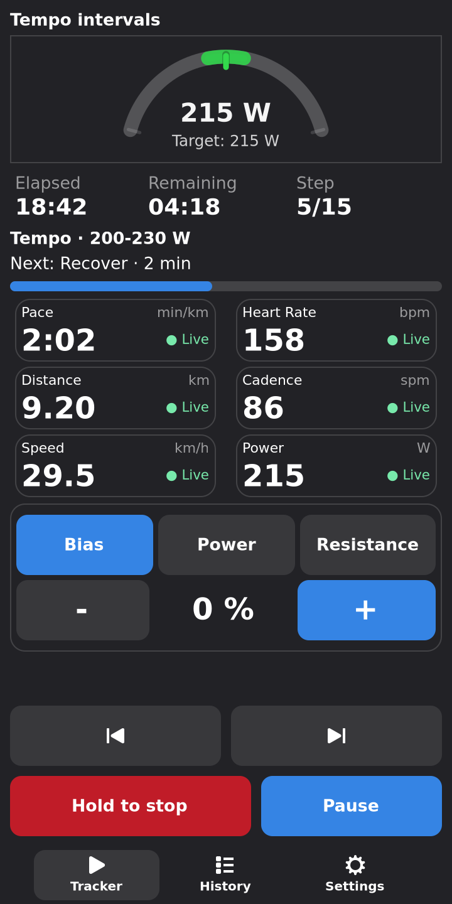
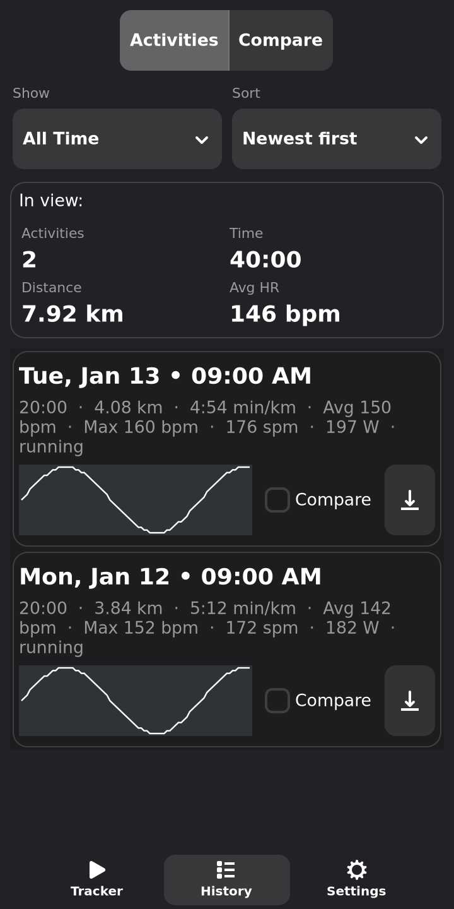
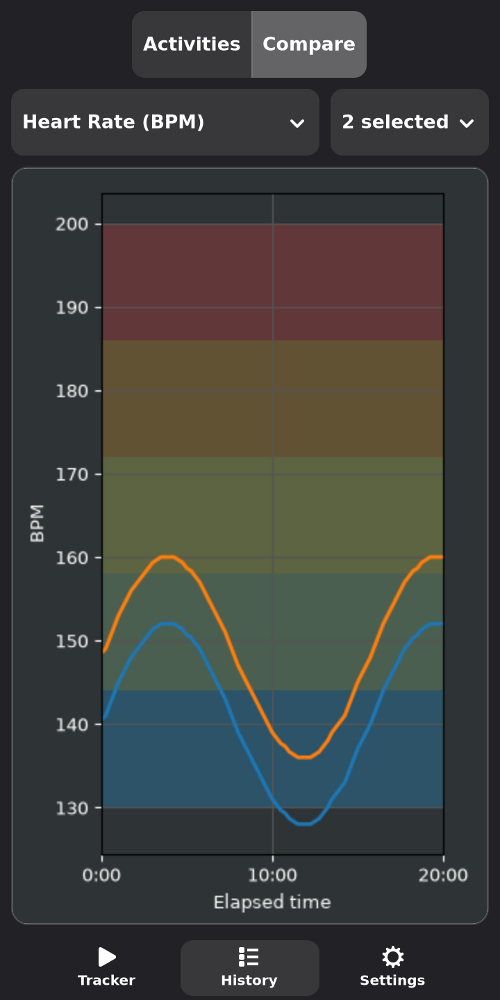

# Fitness Tracker

An open-source application for tracking sensor data from Bluetooth Low Energy (BLE) devices in real time, recording sessions, and visualizing your workout history.

## Features

* **Sensor Monitoring**: Stream from BLE supported devices.
  *  **Heart Rate**
  *  **Foot Pods**
  *  **Bike Smart Trainers** 
* **Workouts**: Add workout fit/json files and visualize the workout during your session.
* **Session Recording**: Start and stop recording sessions; data is stored locally in SQLite.
* **Pebble Companion**: Browse workout guidance, live sensors, and step or session averages. See [watch pages and controls](pebble/README.md).
* **History & Visualization**: Browse past activities by day, week, month, or all time with summary stats and sparkline previews.
* **Two-Way Sync**: Push local sessions to a remote database and pull remote sessions back to your local store.
* **Intervals.ICU**: Upload history to intervals.icu and download workouts for the week.
* **Dark & Light Mode**: Automatic theme adaptation based on your system preferences.

## Prerequisites

* BLE adapter (Bluetooth Low Energy support)
* BLE sensor

For Pebble connections through Cobble, upgrade and restart the host's `cobbled`
daemon alongside `cobble-client`. The 0.8 client requires daemon signals absent
from older versions. Updating Python dependencies does not update the host daemon;
an incompatible daemon causes the bridge to fall back to Bluetooth serial.

## Validated Devices

https://fitness-tracker.luigi311.com/devices/

## Configuration

1. **Set Personal information**: Set your weight, heart rate, ftp values so it can be used to calculate your zones for zone targeting
2. **Select Devices**: Expand the sport sensors and scan/select the sensors for each given category
   Select **GPS** as the speed device under Running Sensors or Cycling Sensors to use
   outdoor location fixes for speed, pace, distance, and available altitude. Cadence,
   heart rate, and power can still come from Bluetooth sensors. GPS metrics require
   location permission and begin after Start; they remain available when **Record
   outdoor routes** is off, without saving coordinates. Indoor and trainer sessions
   do not use GPS for movement metrics.
3. **Set data providers**: Expand the data providers you wish to enable and input information to pull/push your sessions externally
4. **Actions**: Save settings once everything is configured and fetch/upload when needed

## Usage

After installing the project with `uv sync`, the canonical application command is
`uv run fitness-tracker [options]`. From a source checkout, `uv run python main.py
[options]` is also supported and delegates to the same argument parser.

Run `uv run fitness-tracker --test` to simulate missing sensors and include the
bundled `Tempo intervals` workout under both Run and Bike. It lasts two minutes:
a 20-second warm-up, three 20-second tempo efforts with 10-second recoveries,
and a 10-second cool-down. Running uses pace targets; cycling uses power targets.
The bundled workout is shown only in test mode and is not copied into your
workout directories. An existing workout with the same name takes precedence.

* **Tracker Page**: Used to start your session, select the sport and enviornment and then start a workout/freerun and then click start when ready

* **History Page**: See previous sessions with filter for Last 7 Days, Last 30 Days, or All Time. Tick individual sessions and click compare to see more detailed graphs.

* **Settings Page**: Configure your settings and upload/download your sessions/workouts

The session dashboard adapts to the window's logical size and aspect ratio. Tall
phone windows stack guidance above a two-column metric grid; near-square windows
put the gauge beside step details above a three-column grid. Landscape windows
put guidance and metrics side by side. This supports compositor scaling as well
as rotation, including the Comet's 1080×1240 panel at different scale factors.
Recording actions stay visible while secondary content scrolls. Trainer
adjustments appear directly when they fit and use expandable controls on compact
layouts. Incline adjustments remain available in their expandable control.

Workout guidance shows the current reading against its target band in the gauge.
Every metric includes a visible Live or Offline source status, and disconnected
target sensors hide the gauge reading and needle.

For the layout policy and native GTK verification commands, see
[responsive UI notes](docs/responsive-ui.md).

PR CI captures before/after images for six pages across Librem 5, Mecha Comet,
and tablet layouts. See [PR screenshot generation](docs/pr-ui-screenshots.md).

## Screenshots

  
  

  
  

  
  

